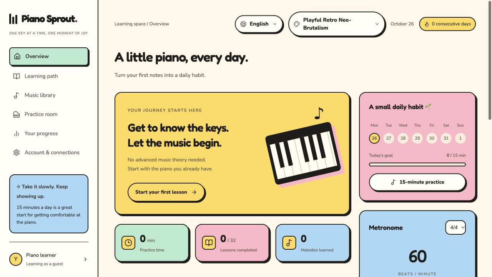

# Piano Sprout — learn piano every day

**English** | [Tiếng Việt](README.vi.md)

Choose **Appearance** beside the language selector to switch between **Sprout**, **Command Line**, **Visual Code**, **Warm Paper**, and **Playful Retro Neo-Brutalism**. Your theme is saved locally, defaults to Sprout, and does not change your language or practice progress.

An open-source piano learning app built with React, TypeScript, and Vite, with a Capacitor 8 iOS app. **English is the default language**; Vietnamese remains available in the language selector. Your choice is saved on your device. Existing Vietnamese preferences are preserved.

Clone, run, fork, modify, and build your own version under the [MIT license](LICENSE). Each deployment uses its own accounts and optional cloud services.

**[Live demo](https://phimpiano.devoralabs.tech/)** — try the maintainer-hosted app, or follow the steps below to run your own instance. The hosted deployment may differ from the latest public commit.

[](https://github.com/devoralabsapp/piano-sprout/actions/workflows/checks.yml)

## Quick start — no cloud account required

Requires Node.js 22.12+ and npm. A `.nvmrc` is included for nvm users.

```sh
git clone https://github.com/devoralabsapp/piano-sprout.git
cd piano-sprout
npm ci
npm run dev
```

Open **http://localhost:5173**. Without environment variables, the app runs in **guest mode** and stores progress in your browser. Firebase, Vercel, and Google accounts are optional. Clearing browser storage may erase guest progress; use the JSON practice-log export to keep a copy.


### Playful Retro Neo-Brutalism

A warm cream canvas, pastel cards, bold outlines, and hard offset shadows. Select it from **Appearance**.



## Features

- 32 lessons across four levels, including scales, chords, arpeggios, and hands-together practice.
- Treble/bass notation, hand and section selection, looping, and a library of 10 practice pieces.
- Sight-reading, placement assessment, rhythm scoring, and practice history.
- A 15-minute daily session, metronome, and animated technique guides.
- On-device single-note microphone input; native CoreMIDI and AVAudioPlayer plugins on iOS.
- Optional Google login through Firebase Auth and progress sync through Firestore with owner-scoped Security Rules.

## Optional Google login and progress sync

Create your own Firebase project, enable Google in Firebase Authentication, and create a Firestore database. Copy `.env.example` to `.env.local` and supply your Firebase Web app configuration. Set `VITE_FIREBASE_DATABASE_ID` to your database ID, deploy the checked-in rules, and authorize your web domain in Firebase Auth.

See [Firebase setup](docs/FIREBASE.md) for environment variables, Security Rules, Vercel, iOS Google login, emulator tests. Never put service-account credentials in client code or commit personal config/user exports. Guest practice works without any cloud configuration.

## Build and test

```sh
npm test
npm run build
npx playwright install chromium
CI=1 npm run test:e2e
CI=1 npm run test:firebase
```

Use `npm run preview` to preview the production build. Keep ports 5173 and 5174 free for Playwright. Auth tests use mocked endpoints, without real Google sign-in or database writes. Default-language tests cover English on a clean browser and Vietnamese preference persistence; other scenarios explicitly select Vietnamese to exercise that interface too.

## iOS

Requires macOS, Xcode, and a compatible iOS Simulator runtime:

```sh
npm run ios:sync
npm run ios:open
```

Open the **App** scheme. The public project uses the placeholder bundle ID `org.example.phimpiano` and an empty Apple Team. Choose your own Team and bundle ID before installing on a device; see the [iOS, MIDI, and audio guide](docs/IOS.md).

The existing `com.phim.piano` URL scheme is retained. Firebase Google login adds its own reversed client ID scheme using your ignored iOS plist; see [Firebase iOS setup](docs/FIREBASE.md#ios).

```sh
swift test --package-path native/MidiParser
swift test --package-path native/PianoAudio
xcodebuild -project ios/App/App.xcodeproj -scheme App -sdk iphonesimulator \
  -configuration Debug -destination 'generic/platform=iOS Simulator' \
  CODE_SIGNING_ALLOWED=NO build
```

A simulator build does not verify audio, microphone, or USB MIDI behavior on physical devices. Use the native iOS app for USB MIDI; microphone input recognizes clear single notes, not chords. Headphones help prevent audio feedback.

## Deploy and customize

Deploy `dist` to hosting that supports single-page apps. The Vercel example uses Vite, build command `npm run build`, and output directory `dist`. Configure your own environment variables and a rewrite to `index.html` for OAuth callbacks. Web device features generally require HTTPS outside localhost.

The example `vercel.json` blocks web microphone access through Permissions-Policy. If your deployment needs it, consider `microphone=(self)` and verify browser permission behavior. iOS uses its own microphone permission. No deployment automation or shared production database account is included.

See the [course guide](docs/COURSE.md) and [promo-video renderer](marketing/tiktok/README.md). `docs/prototype.html` is an older Vietnamese prototype; the current app is in `src/`.

## Contributing and license

Fork the repository, create a branch, make changes, and open a pull request. Run relevant checks before submitting. Do not include user data or credentials in code, screenshots, or logs. Keep dependency versions unchanged unless your change requires otherwise.

Original code and content are released under [MIT](LICENSE). Dependencies retain their own licenses; see [THIRD_PARTY_NOTICES.md](THIRD_PARTY_NOTICES.md). Cloud subscriptions, Apple developer accounts, and rights to third-party brands are not included.

## Community and project direction

Read [CONTRIBUTING.md](CONTRIBUTING.md), the [Code of Conduct](CODE_OF_CONDUCT.md), and [SECURITY.md](SECURITY.md). Explore the [architecture](docs/ARCHITECTURE.md), [roadmap](docs/ROADMAP.md), and [maintainer workflow](docs/MAINTAINER-WORKFLOW.md). [AGENTS.md](AGENTS.md) provides repository guidance for coding tools. This is an early-stage project; roadmap items describe proposed work rather than adoption or funding claims.

The display name is Piano Sprout. Historical `phim:*` storage keys, lesson IDs, the sample iOS bundle ID, and the `com.phim.piano` OAuth scheme are retained for compatibility; renaming the app does not migrate or erase practice history.
