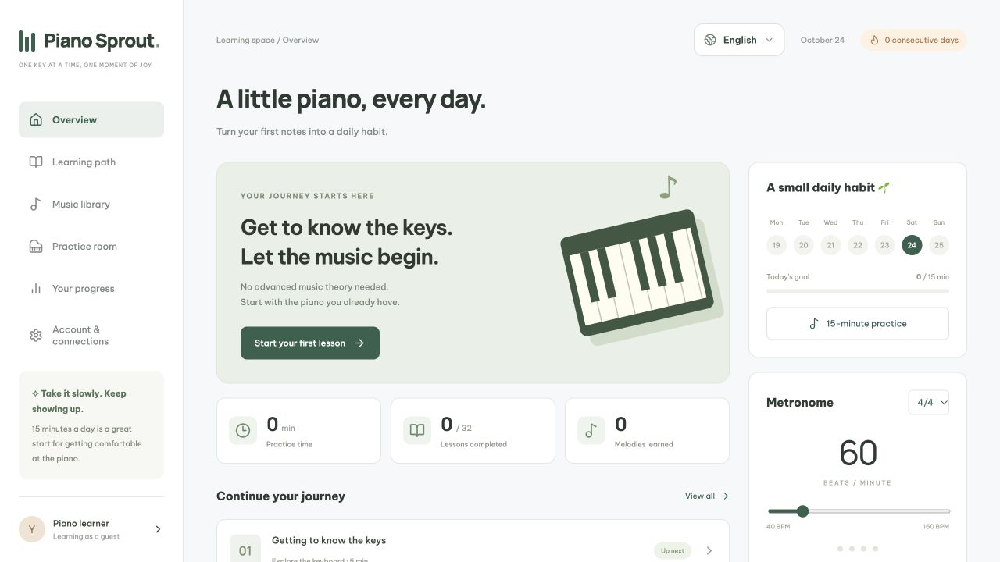

[English](README.md) | **Tiếng Việt**

# Piano Sprout — học piano mỗi ngày

Chọn **Appearance / Giao diện** bên cạnh ngôn ngữ để đổi giữa Sprout, Command Line, Visual Code và Warm Paper. Theme được lưu riêng trên thiết bị; mặc định là Sprout và không ảnh hưởng tiến độ hay ngôn ngữ.

Ứng dụng học piano mã nguồn mở bằng React, TypeScript và Vite, có bản iOS bằng Capacitor 8. Mặc định tiếng Anh; bạn vẫn có thể chọn Tiếng Việt trong bộ chọn ngôn ngữ. Giao diện tiếng Việt/English; hỗ trợ luyện bằng phím màn hình, micro từng nốt và USB MIDI trong app iOS.

Bạn có thể tải mã, chạy trên máy, fork, sửa và phát triển phiên bản của mình theo giấy phép [MIT](LICENSE). Mỗi bản triển khai tự cấu hình dịch vụ và tài khoản riêng.

**[Dùng thử trực tuyến](https://phimpiano.devoralabs.tech/)** — mở bản do maintainer vận hành, hoặc làm theo hướng dẫn dưới đây để chạy bản riêng. Website có thể khác commit mới nhất của repo public.

[](https://github.com/devoralabsapp/piano-sprout/actions/workflows/checks.yml)

## Chạy nhanh — không cần tài khoản cloud

Cần Node.js 22.12+ và npm.

```sh
git clone https://github.com/devoralabsapp/piano-sprout.git
cd piano-sprout
npm ci
npm run dev
```

Mở **http://localhost:5173**. Khi chưa có biến môi trường, ứng dụng chạy ở **chế độ khách** và lưu tiến độ trong trình duyệt. Không cần Supabase, Vercel hoặc tài khoản Google để học thử. Xóa dữ liệu trình duyệt có thể làm mất tiến độ khách; có chức năng xuất nhật ký JSON.



## Tính năng

- 32 bài học ở 4 cấp độ, gam, hợp âm, arpeggio và luyện hai tay.
- Khuông nhạc Sol/Fa, chọn tay/đoạn và lặp đoạn; thư viện 10 bản luyện.
- Đọc nhạc mới, đánh giá đầu vào, luyện/chấm tiết tấu và nhật ký tiến độ.
- Buổi luyện 15 phút, máy đếm nhịp và video hoạt họa kỹ thuật.
- Micro xử lý từng nốt trên thiết bị; app iOS có plugin CoreMIDI và AVAudioPlayer.
- Google OAuth PKCE và đồng bộ tiến độ qua Supabase tùy chọn, có Row Level Security.

## Google login và đồng bộ tiến độ — tùy chọn

```sh
cp .env.example .env.local
```

Điền URL và anon/publishable key của **project Supabase do bạn sở hữu**:

```dotenv
VITE_SUPABASE_URL=
VITE_SUPABASE_ANON_KEY=
```

Giữ trống cả hai biến để chạy chế độ khách. Không đưa service-role key, Google Client Secret, token quản trị hoặc mật khẩu vào biến `VITE_` vì chúng được bundle vào client. Không commit `.env.local`.

Xem [cấu hình Supabase/Google/hosting](docs/SETUP.vi.md). SQL dành cho project mới ở `supabase/setup/new-project.sql`; chỉ chạy một lần trên project mới của bạn. Project đã có dữ liệu cần xem và áp dụng từng migration còn thiếu; không chạy lại script khởi tạo. Google OAuth cần cấu hình và kiểm tra bằng tài khoản của bạn.

## Build và kiểm thử

```sh
npm test
npm run build
npx playwright install chromium
CI=1 npm run test:e2e
CI=1 npm run test:auth
```

`npm run preview` xem bản build. Playwright dùng cổng 5173 và 5174; giữ hai cổng trống khi chạy. Auth tests dùng API mô phỏng, không đăng nhập Google hoặc ghi database thật.

## iOS

Cần macOS, Xcode và runtime iOS Simulator phù hợp:

```sh
npm run ios:sync
npm run ios:open
```

Mở scheme **App**. Bundle ID trong bản public là mẫu `org.example.phimpiano`, Apple Team để trống. Chọn Team và bundle ID riêng của bạn trước khi cài thiết bị; xem [hướng dẫn iOS/MIDI/âm thanh](docs/IOS.vi.md). Callback OAuth mặc định vẫn là `com.phim.piano://auth/callback`, khác bundle ID theo chủ ý. Nếu tùy biến scheme, cập nhật đồng bộ auth, Info.plist và allowlist của Supabase.

```sh
swift test --package-path native/MidiParser
swift test --package-path native/PianoAudio
xcodebuild -project ios/App/App.xcodeproj -scheme App -sdk iphonesimulator \
  -configuration Debug -destination 'generic/platform=iOS Simulator' \
  CODE_SIGNING_ALLOWED=NO build
```

Build simulator không xác nhận âm thanh, micro hoặc USB MIDI hoạt động trên thiết bị thật. Safari không cung cấp USB MIDI như plugin native của app iOS. Micro chỉ nhận từng nốt rõ, không nhận hợp âm; nên dùng tai nghe để tránh phản hồi âm thanh.

## Tự triển khai và tùy biến

Có thể đưa thư mục `dist` lên hosting hỗ trợ SPA. Cấu hình mẫu Vercel: framework Vite, build `npm run build`, output `dist`. Đặt biến môi trường của chính bạn và cấu hình rewrite về `index.html` cho callback OAuth. HTTPS cần thiết cho các tính năng thiết bị trên web ngoài localhost.

`vercel.json` hiện chặn microphone trên bản web bằng Permissions-Policy; nếu cần micro web, xem xét cho phép `microphone=(self)` theo mô hình triển khai và kiểm tra quyền thực tế. Mã iOS có quyền micro riêng. Không có cấu hình tự deploy hoặc kết nối sẵn tới một website/database đang vận hành.

Xem [lộ trình học](docs/COURSE.vi.md), [renderer video quảng bá](marketing/tiktok/README.vi.md). `docs/prototype.html` là prototype cũ; ứng dụng hiện tại nằm trong `src/`.

## Đóng góp và giấy phép

Fork repo, tạo nhánh, sửa mã và gửi pull request. Chạy các kiểm tra phù hợp trước khi gửi; không đính kèm dữ liệu người dùng hoặc credentials trong mã, ảnh chụp hay logs. Không thay phiên bản dependencies nếu thay đổi của bạn không cần tới.

Mã nguồn và nội dung gốc trong repo được phát hành theo [MIT](LICENSE). Các dependencies giữ giấy phép riêng; xem [THIRD_PARTY_NOTICES.md](THIRD_PARTY_NOTICES.md). Không có dịch vụ cloud trả phí, tài khoản nhà phát triển Apple hoặc quyền dùng thương hiệu bên thứ ba đi kèm.

## Cộng đồng và hướng phát triển

Xem [hướng dẫn đóng góp](CONTRIBUTING.md), [quy tắc ứng xử](CODE_OF_CONDUCT.md), [báo cáo bảo mật](SECURITY.md), [kiến trúc](docs/ARCHITECTURE.md) và [roadmap](docs/ROADMAP.md). Các tài liệu cộng đồng này dùng tiếng Anh. Dự án còn ở giai đoạn đầu; roadmap là công việc dự kiến, không phải tuyên bố về lượng người dùng hoặc tài trợ.
